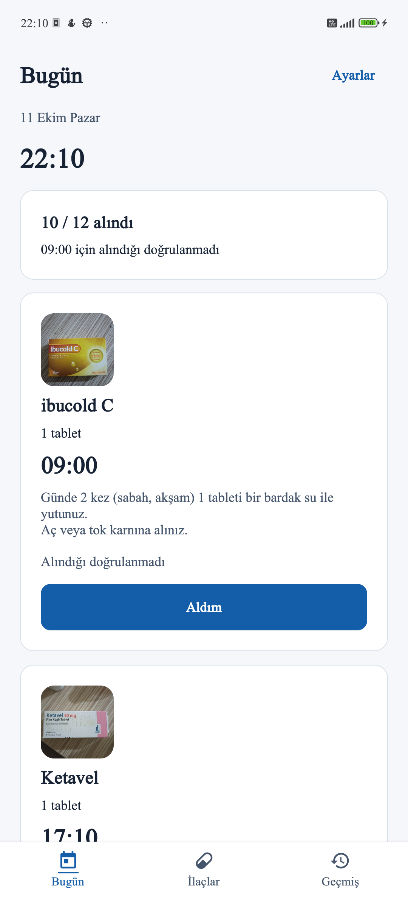
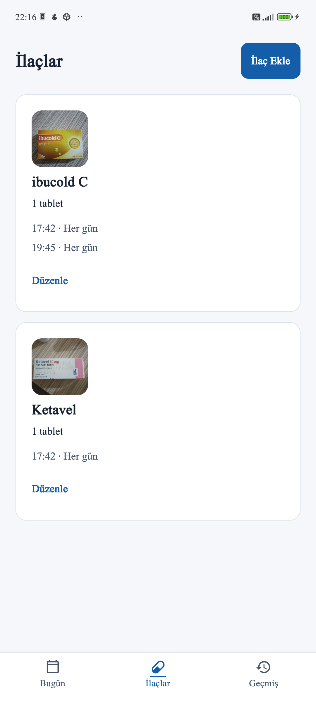
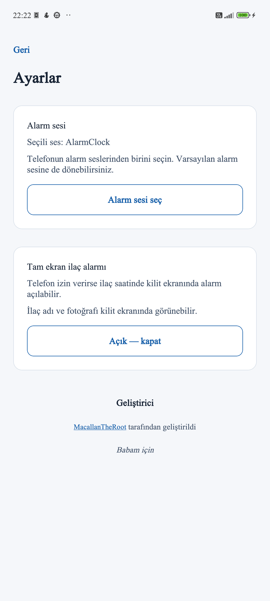

[🇹🇷 Türkçe](#tr) | [🇬🇧 English](#en)

## İlaç Hatırlatıcı

Android için sade, çevrimdışı ilaç hatırlatıcısı. Bu uygulamayı babamın ilaçlarını zamanında hatırlamasına yardımcı olmak için geliştirdim. Karmaşık bir sağlık platformu kurmak yerine günlük kullanımda okunaklı, pratik ve anlaşılır olmasına odaklandım.

### Ekran görüntüleri

Xiaomi Android 13 üzerinde çalışan uygulamanın gerçek görüntüleri; sırasıyla **Bugün**, **İlaçlar** ve **Ayarlar**. Görüntüye dokunarak özgün boyutta açabilirsiniz.

  
  
  

Görünen ilaçlar ve ambalajlar gerçek ticari ürünlere aittir; bu ürünler tıbbi öneri değildir ve markaları projeye sponsor değildir. Geçmiş ve diğer ekranlar yayımlama onayı almadı. [Görsel inceleme ilkeleri](docs/screenshots/CAPTURE_PLAN.md).

### Özellikler

- İlaç adı, doz, talimat, yerel fotoğraf ve haftalık saat planı
- Ayarlar'dan açılabilen, Android izin verirse kilit ekranında otomatik açılan tam ekran alarm; aynı saatteki ilaçların sırayla gösterimi ve ayrı doz kayıtları
- Telefonun varsayılan **alarm** sesi veya Android sistem seçicisinden seçilen alarm melodisi
- Bildirimden veya alarm ekranından **Aldım** ve **5 dk ertele**
- Bugün ve Geçmiş görünümleri; alınan doz yalnızca açık **Aldım** onayıyla işaretlenir, yanıtsız doz doğrulanmamış kalır
- Hesapsız, çevrimdışı, cihaz içi SQLite saklama

### Kurulum ve izinler

**APK henüz GitHub'da yayımlanmadı.** Yayımlandığında [GitHub Releases](https://github.com/MacallanTheRoot/ilac-hatirlatici/releases) sayfasındaki `ilac-hatirlatici-v1.0.0.apk` ve `.sha256` dosyasını kullanın. Sağlama toplamını doğrulayın, APK'yı Android'de açın ve kurulum istemini onaylayın. Android gerekirse yalnızca indirmeyi açan uygulamaya bu kurulum için izin vermenizi ister. B2 APK manifestinde minimum Android **7.0 (API 24)**, sürüm **1.0.0** doğrulandı.

Android 13 ve üzeri bildirim izni ister; kesin alarm erişimi Android sürümüne göre ayrıca gerekebilir. Tam ekran alarm **varsayılan olarak kapalıdır**: Ayarlar'dan açılır ve Android 14 ve üzeri cihazlarda sistemin tam ekran bildirim izni de gerekir. Tam ekran kullanılamadığında normal bildirim yolu kalır. Rahatsız Etmeyin, ses düzeyi, bildirim kanalı ve üreticinin pil yönetimi uyarıları etkileyebilir.

### Geliştirme

Expo SDK 57, React Native, TypeScript, Expo Router, Expo Notifications ve SQLite kullanılır. Yerel Android modülü sistem alarm sesini seçer ve bildirim kanalını yönetir. Yerel Expo Notifications yaması tam ekran intent ekler; `npm install` sırasında doğrulanır.

    npm ci
    npx expo install --check
    npx tsc --noEmit
    npm run lint
    npm run test:alarms
    npx expo export --platform android

Gerçek alarm davranışı Expo Go içinde doğrulanamaz. `eas build --platform android --profile preview` bağımsız test APK'sı üretir; kaynak değişirse yeni derleme ve cihaz kabulü gerekir.

### Gizlilik ve sınırlar

İlaçlar, fotoğraflar ve doz geçmişi cihazda tutulur; hesap, uygulama sunucusu, reklam ve izleme yoktur. Bulut yedeği yoktur. Uygulama tanı, tedavi, reçete veya otomatik tıbbi değerlendirme sunmaz. Yanıtlanmayan doz otomatik olarak alınmış ya da kaçırılmış sayılmaz. Arayüz şu anda yalnızca Türkçedir.

### Test kapsamı ve sınırlar

B2 sürümü **Xiaomi Android 13** üzerinde kilit ekranı uyandırma, gerçek telefon alarm sesi, aynı anda birden fazla ilaç, beş dakika erteleme ve arka planda/son uygulamalardan kapatıldıktan sonra bildirim için fiziksel olarak sınandı. Daha önce bir aralıklı ekran uyandırma başarısızlığı görüldü; sonraki denemelerde tekrarlanmadı. Her Android modelinde veya her koşulda uyarı garantisi verilmez. **Samsung henüz fiziksel olarak kabul edilmedi.**

### Lisans ve yol haritası

Uygulamanın özgün kaynak kodu [MIT lisansı](LICENSE) altındadır. Expo ve diğer bağımlılıkların kendi lisansları geçerlidir; [üçüncü taraf bildirimleri](THIRD_PARTY_NOTICES.md) ayrıca incelenebilir. Sürüm 2 için sigarayı bırakma takibi, İngilizce, açık/koyu/sistem teması ve arayüz iyileştirmeleri ayrı bir taslak PR'da önerilecektir; bunlar sürüm 1 özelliği değildir.

Geliştirici: [MacallanTheRoot](https://github.com/MacallanTheRoot/) · *Babam için*.

## Medication Reminder

A simple, offline Android medication reminder I built for my father. I kept it readable and practical for daily use instead of turning it into a complicated healthcare platform.

### Screenshots

Genuine app screens captured on Xiaomi Android 13, in order: **Today**, **Medications**, and **Settings**. Open an image to see the original resolution.

  
  
  

Visible medicines and packaging are real commercial products. They are not medical recommendations, and their brands do not sponsor this project. History and other screens have not been approved for publication. See the [image review policy](docs/screenshots/CAPTURE_PLAN.md).

### Features

- Medication name, dosage, instructions, local photo, and weekly schedules
- Automatic full-screen alarm on a locked phone when enabled in Settings and allowed by Android; simultaneous medicines appear in order with separate dose records
- Device default **alarm** ringtone or a melody chosen in Android's system alarm ringtone picker
- **Taken** and **snooze five minutes** from the alarm or notification
- Today and History; only explicit **Taken** confirmations count as taken, while unanswered doses remain unconfirmed
- Offline SQLite storage, with no account

### Installation and permissions

**The APK is not published on GitHub yet.** Once available, download `ilac-hatirlatici-v1.0.0.apk` and its `.sha256` file from [GitHub Releases](https://github.com/MacallanTheRoot/ilac-hatirlatici/releases). Verify the checksum, open the APK on Android, and approve the installation prompt. Android may ask you to allow installation from the app you used to open the download. The B2 APK manifest confirms minimum **Android 7.0 (API 24)** and version **1.0.0**.

Android 13+ asks for notification permission; exact-alarm access may also be needed depending on Android version. The full-screen alarm is **off by default** and requires an app Settings opt-in plus Android full-screen notification access on Android 14+. Ordinary notifications remain when full-screen access is unavailable. Do Not Disturb, volume, channel settings, and manufacturer battery controls can affect alerts.

### Development

Built with Expo SDK 57, React Native, TypeScript, Expo Router, Expo Notifications, and SQLite. A small local Android module handles the alarm ringtone picker and channels. A checked local Expo Notifications patch adds the full-screen intent during `npm install`.

    npm ci
    npx expo install --check
    npx tsc --noEmit
    npm run lint
    npm run test:alarms
    npx expo export --platform android

Expo Go cannot validate the native alarm path. `eas build --platform android --profile preview` creates a standalone test APK; source changes require a new build and device acceptance.

### Privacy and limitations

Medication details, photos, and dose history stay on the device. There is no account, app backend, advertising, or tracking, and no cloud backup. The app does not diagnose, prescribe, recommend treatment, or automatically judge unanswered doses as missed. The current interface is Turkish-only.

### Tested device and limitations

B2 was physically tested on **Xiaomi Android 13** for lock-screen wake, the actual device alarm ringtone, simultaneous medication handling, five-minute snooze, and delivery while backgrounded or swiped from Recents. One intermittent wake failure was observed earlier but did not recur in later tests. Alerts cannot be guaranteed on every Android model or under all device settings. **Samsung has not been physically accepted.**

### License and roadmap

The application's original source is under the [MIT license](LICENSE). Expo and other dependencies retain their own terms; see [third-party notices](THIRD_PARTY_NOTICES.md). Smoking cessation tracking, English, light/dark/system theme, and UI improvements are proposed for a separate version 2 draft PR and are not v1 features.

Developer: [MacallanTheRoot](https://github.com/MacallanTheRoot/) · *For my father*.
